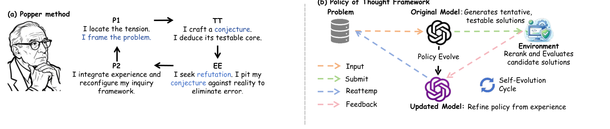
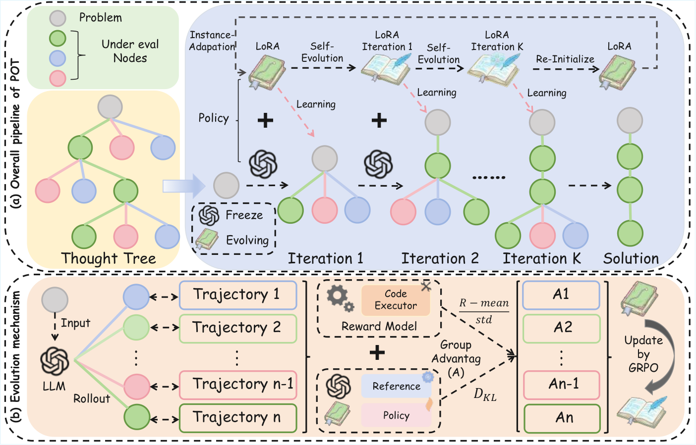
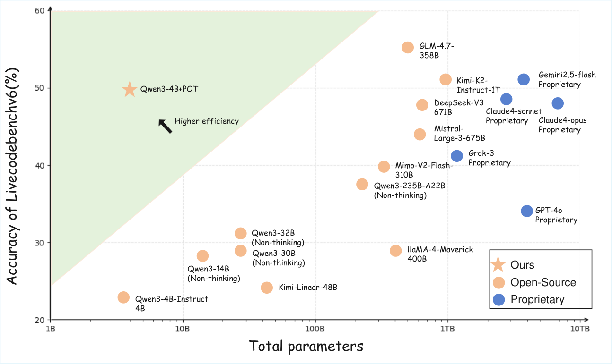
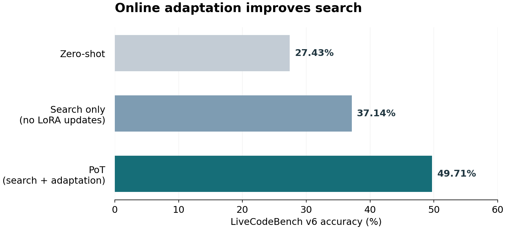

<div align="center">

# Policy of Thoughts (PoT)
### Scaling Test-Time Training for LLM Reasoning via Online Policy Evolution

Zhengbo Jiao<sup>&#42;</sup> · Hongyu Xian<sup>&#42;</sup> · Qinglong Wang · Yunpu Ma<br>
Zhebo Wang · Zifan Zhang · Dezhang Kong<sup>†</sup> · Meng Han<sup>†</sup>

<sup>&#42;</sup> Equal contribution (co-first authors) &nbsp; <sup>†</sup> Corresponding authors

**EMNLP 2026 · Oral Presentation**

[](https://arxiv.org/abs/2601.20379v2)
[](https://aclanthology.org/2026.emnlp-main.1908/)
[](https://www.python.org/)
[](LICENSE)

[Paper](https://arxiv.org/abs/2601.20379v2) · [Quick start](#quick-start) · [Method](docs/METHOD.md) · [Citation](#citation)

</div>

**PoT learns while it searches.** Each coding problem becomes a small online learning loop: generate candidate solutions, execute them, and use their relative rewards to update a temporary LoRA adapter. Subsequent attempts benefit from both the search history and an improved policy. The adapter resets for the next problem.

## Overview

Inspired by Popper's cycle of conjecture and refutation, PoT turns execution feedback into a policy update. A reasoning tree preserves alternative approaches, while lightweight test-time training changes how the model explores them.

<p align="center"></p>

1. **Explore.** Select a promising branch and sample three reasoning-and-code continuations.
2. **Learn.** Execute the selected Python program from each response. Relative rewards guide a LoRA update over the model outputs along each trajectory.
3. **Try again.** Evaluate a greedy candidate from the updated policy, then continue searching until the task is solved or the budget is exhausted.

<p align="center"></p>

The implementation combines PUCT search, sibling-relative GRPO updates, full-trajectory model-output loss, and a transient per-problem adapter. vLLM serves generation; independent question workers can share multiple GPUs.

## Results reported in the paper

The following values are from **Table 1 of the paper, arXiv v2**, using Qwen3-4B-Instruct-2507. They are paper-reported percentages, not a new benchmark run of this source release. Overall follows the paper's aggregate.

| Method | HumanEval | MBPP | LCB v5 | LCB v6 | ICPC | Overall |
|---|---:|---:|---:|---:|---:|---:|
| Zero-shot | 84.76 | 79.77 | 30.54 | 27.43 | 6.80 | 45.86 |
| Best-of-N (N=20) | 90.85 | 82.10 | 43.61 | 37.71 | 9.59 | 52.77 |
| LATS | 87.80 | 90.66 | 47.51 | 43.43 | 13.69 | 56.62 |
| RethinkMCTS | 89.02 | 87.34 | 49.83 | 44.12 | 15.07 | 57.08 |
| **PoT** | **98.78** | **94.94** | **57.49** | **49.71** | **19.18** | **64.02** |

PoT improves LCB v6 by **22.28 percentage points** over the same model's zero-shot result. See the [paper](https://arxiv.org/html/2601.20379v2) for experimental details and ablations.

### Model scale and reasoning accuracy

<p align="center"></p>

Figure 2 of the paper compares model scale and LiveCodeBench v6 accuracy. PoT reaches **49.71%** with a 4B backbone.

### What does online adaptation add?

<p align="center"></p>

Redrawn from **Table 3 of arXiv v2**. Online LoRA updates add **12.57 percentage points** over search alone on LiveCodeBench v6, using the same Qwen3-4B-Instruct-2507 backbone.

## Evaluation protocol in this release

All available test cases contribute to scalar rewards, candidate selection, and all-tests-pass stopping. **Only public examples and public execution diagnostics enter the model's conversation.** Hidden test inputs, expected outputs, and failure details are excluded from feedback. Each response contributes only its last closed Python block; feedback identifies and quotes the evaluated code.

This is an **all-test-reward** protocol. Appendix D.1 of the paper specifies disjoint reward and final evaluation tests. Report results from this implementation as adaptive solve rates under the stated protocol, rather than held-out pass@1. [Method and paper correspondence](docs/METHOD.md) documents this difference and the concrete search, training, and budget conventions.

## Quick start

### Installation

```bash
git clone https://github.com/Frostlinx/Policy-of-Thought.git
cd Policy-of-Thought
```

Use Linux, Python 3.10+, and a CUDA environment compatible with vLLM 0.21.0.

```bash
python -m pip install -e '.[vllm,data,test]'
```

For an existing compatible environment, install the package without replacing
its dependencies: `python -m pip install -e . --no-deps`.
The tested direct dependencies are recorded in `requirements-tested.txt`.
OJBench needs a separate DMOJ/PyPy environment; see
[competition setup](docs/COMPETITIONS.md).

### Download model and data

```bash
python scripts/download_model.py --output ./models/Qwen3-4B-Instruct-2507
python scripts/download_lcb.py --selection v5 --output ./data/lcb-v5
```

Downloads use `hf-mirror.com`. If authentication is needed, provide `HF_TOKEN`
through the environment. `--aria2` enables aria2c; `--no-proxy` bypasses proxy
environment settings. Dataset revisions and integrity checks are pinned by the
downloaders. Models and datasets are downloaded separately and are not included
in this package.

### Run LiveCodeBench

Start a tmux session so the run survives a disconnected terminal:

```bash
tmux new-session -s pot-lcb-v5
bash scripts/run_benchmark.sh \
  --model ./models/Qwen3-4B-Instruct-2507 \
  --data ./data/lcb-v5 --selection v5 --output ./runs/lcb-v5 \
  --gpus 0 --workers-per-gpu 1 --limit 167
```

The launcher uses CLI arguments only. It sets the release defaults explicitly:
20 expansions, 3 sampled siblings, 2048 output tokens, 16384 context tokens,
full-path model-output loss, and KL coefficient 0.02. Caller-supplied flags can
override them. `python -m pot.parallel --help` lists the available options.

Each question worker has a persistent vLLM server and HF trainer. Increase
`--workers-per-gpu` and list additional GPUs to run independent questions in
parallel. Admission depends on free memory. Use `--shared-gpus` only for devices
where sharing is intended. KV cache size is not a limit on total GPU memory;
training peaks also depend on trajectory length.

Resume with the same command and output directory. The coordinator checks
source, configuration and dataset identity, retains completed results, and
retries infrastructure failures up to three times per question. Use a new
output directory when the source identity changes.

## Benchmarks

| Selection | Tasks | Interface |
|---|---:|---|
| `v5` | 167 | LCB stdio / `Solution` method |
| `v6` | 175 | LCB stdio / `Solution` method |
| `humaneval` | 164 | Complete Python module with required function |
| `mbpp-sanitized` | 257 | Complete Python module with required functions |
| `ojbench-icpc` | 73 | Official DMOJ judge, including interactive problems |

LCB v5/v6 here refer to their new-problem increments, not cumulative releases.
See [HumanEval/MBPP](docs/BENCHMARKS.md) and
[LCB/OJBench](docs/COMPETITIONS.md) for download commands and scoring units.

## Outputs

| File | Contents |
|---|---|
| `summary.json` | Completed/correct counts, accuracy, mean pass rate, timing |
| `process.json` | One JSON object per completed question: ID, score, pass rate, time, tokens and updates |
| `progress.json` | Worker status and current questions |
| `metadata.json` | Effective configuration, versions and source/data hashes |
| `execution_failures.json` | Infrastructure failures, separate from wrong answers |
| `jobs/*/trace.jsonl` | Candidate responses, selected code, public diagnostics and update metrics |
| `jobs/*/evaluation_timing.jsonl` | Test status and timing, without test contents |

JSONL aliases/history are also written. Cumulative question time is the sum of
individual question durations; it is not the elapsed wall time of a parallel run.

## Development and testing

```bash
python -m pytest tests -q
python -m pot.run --help
python -m pip install build
python -m build
```

Tests cover rewards, stopping, feedback boundaries, code extraction, interfaces,
GRPO gradients, trajectory weighting, adapter resets, and queue recovery.
Optional Docker and real-model checks require their corresponding environments.

The subprocess executor applies time, memory and output limits but retains the
host user's filesystem permissions. Run generated code in a dedicated execution
environment; a Docker executor is available for supported benchmarks. OJBench
uses its separate pinned judge. See [third-party notices](THIRD_PARTY_NOTICES.md)
and [release notes](docs/RELEASE.md) for dependency and packaging details.

## Repository guide

| Path | Purpose |
|---|---|
| `pot/search.py` | Search tree, selection, rewards, updates and stopping |
| `pot/backend.py` | Generation interface, trajectory loss and LoRA lifecycle |
| `pot/parallel.py` | Multi-GPU workers, resume and progress reporting |
| `pot/prompts.py` | Reasoning, code and feedback templates |
| `scripts/` | Model/data downloads and command-line launchers |
| `tests/` | Algorithm, evaluator and integration checks |
| `docs/` | Method details, benchmark setup and evaluation conventions |

## Citation

```bibtex
@article{jiao2026policyofthoughts,
  title={Policy of Thoughts: Scaling Test-Time Training for LLM Reasoning via Online Policy Evolution},
  author={Jiao, Zhengbo and Xian, Hongyu and Wang, Qinglong and Ma, Yunpu and Wang, Zhebo and Zhang, Zifan and Kong, Dezhang and Han, Meng},
  journal={arXiv preprint arXiv:2601.20379},
  year={2026},
  url={https://arxiv.org/abs/2601.20379v2}
}
```

## License and acknowledgments

The code is released under the [MIT License](LICENSE). We thank the maintainers of vLLM, Transformers, PEFT, LiveCodeBench, HumanEval, MBPP, OJBench and DMOJ. Paper figures, adapted evaluation utilities and external assets retain their respective terms; see [third-party notices](THIRD_PARTY_NOTICES.md).
